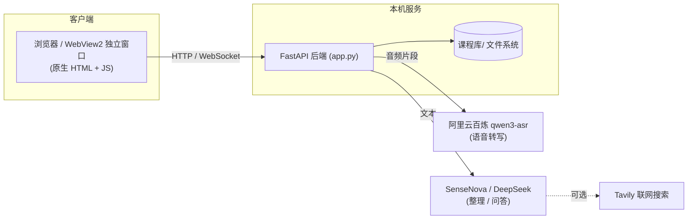
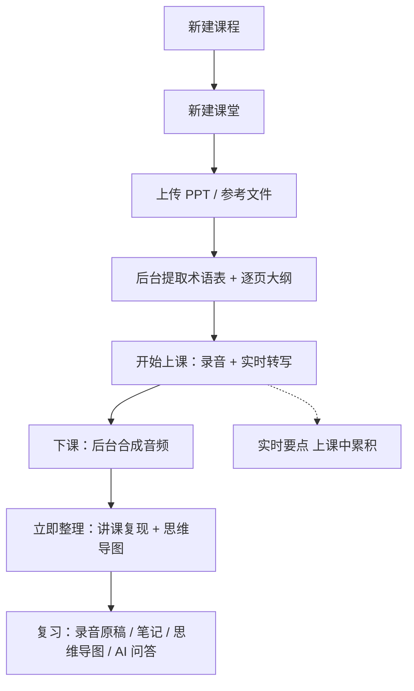
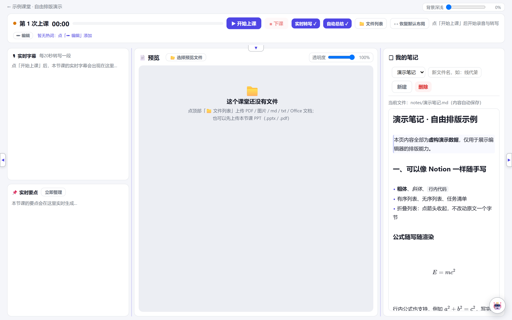
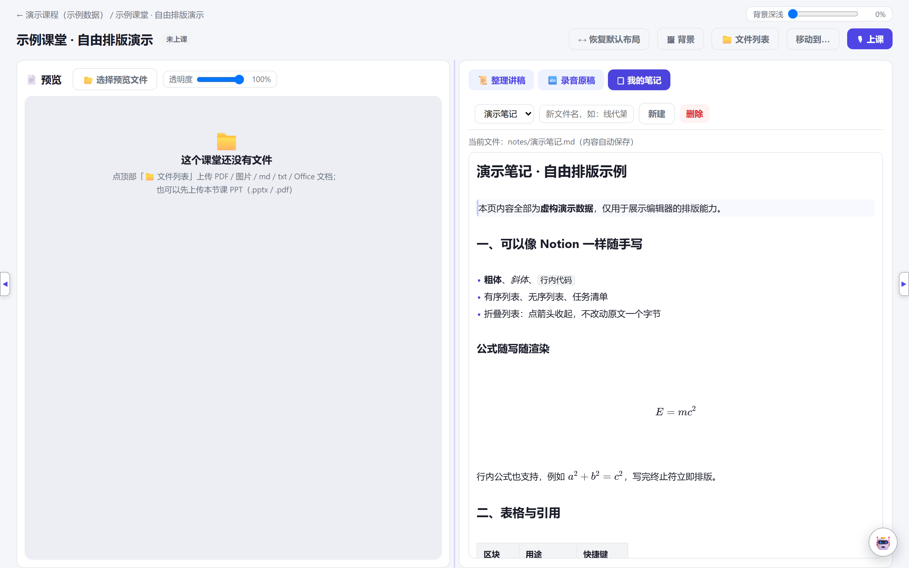
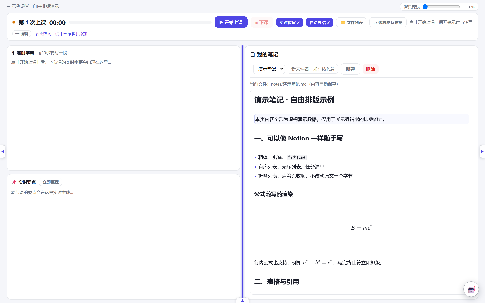
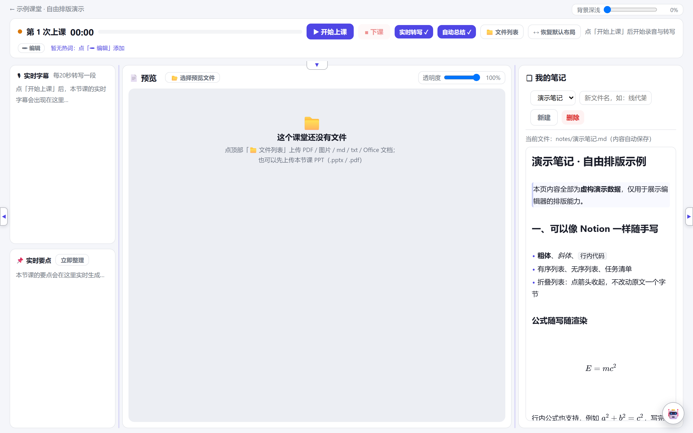
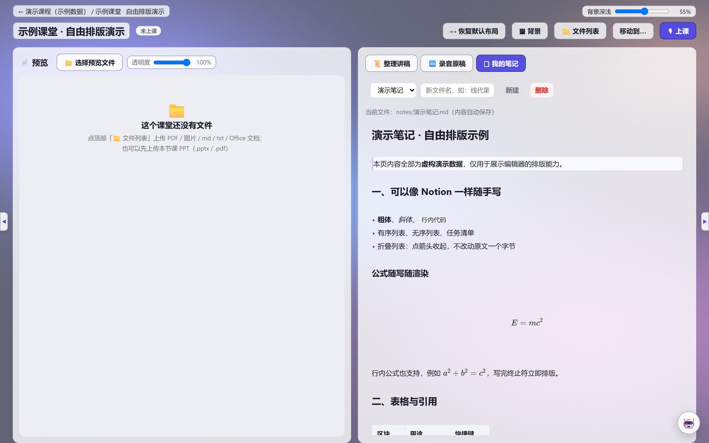
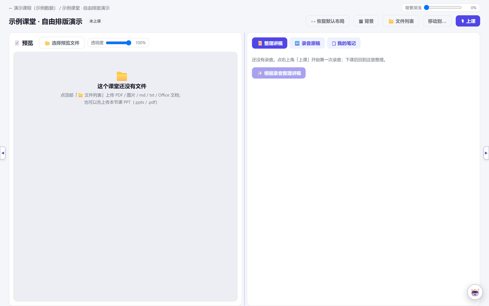
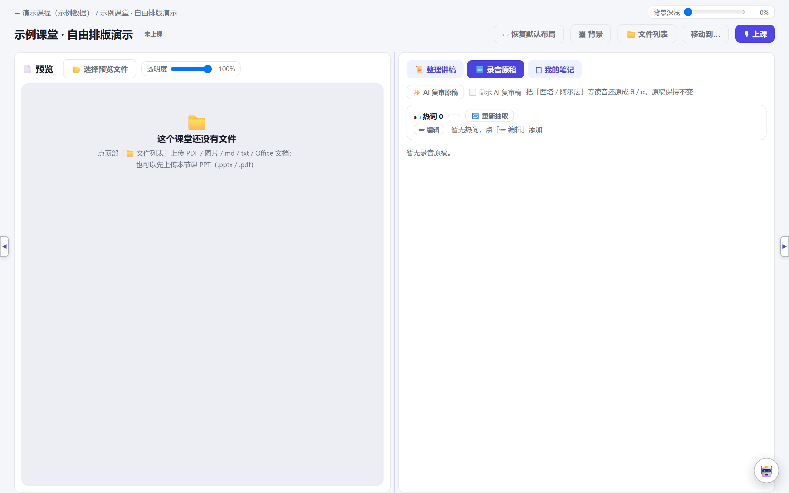
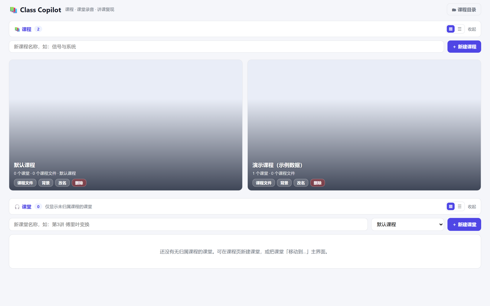

# Class Copilot

> **给课堂做的「Notion + NotebookLM」本地替代品** —— 左边是课件，中间是录音与 AI 整理，右边是你随手写的 Markdown 笔记。三栏可折叠、可拖拽调宽、可换背景；下课后 AI 对照课件逐页生成**讲课复现讲稿 + 思维导图 + 实时要点**。全部资料（课件、录音、字幕、讲稿、笔记、问答）只落在你自己的磁盘上。

[](https://www.python.org/)
[](LICENSE)
[]()

---

## 为什么要做它

**Notion 的笔记排版足够自由，但它不知道你今天上了什么课；NotebookLM 把资料和 AI 结合得很好，但笔记结构是固定的，数据也在云上。** 这个项目想把两者放进同一页，并且让整堂课的资料留在本机：

- **像 Notion 一样自由** —— 完整 Markdown、KaTeX 公式、管道表、代码块、折叠列表、插图、`/` 斜杠命令；三栏折叠 / 拖拽调宽 / 自定义底图与透明度，调节按课堂分别记住；
- **像 NotebookLM 一样 AI 全程在场** —— 课件抽术语喂给转写、实时字幕与要点、下课逐页对齐 PPT 整理讲稿、就地问答（可选联网附来源）；
- **但数据完全本地** —— 目录 + JSON 落盘，无数据库、无云盘，备份一个 `课程库/` 就搬走。

| | Notion | NotebookLM | Class Copilot |
|---|---|---|---|
| 笔记排版 | 块编辑，自由 | 跟随资料，结构固定 | 完整 Markdown + 公式 / 表格 / 代码 / 折叠列表 |
| AI 与课堂资料 | 需自己接 | 深度绑定资料 | 课件 / 录音 / 字幕 / 讲稿全程打通 |
| 上课录音 + 实时字幕 | — | — | ✅ 带时间戳、热词纠错 |
| 讲稿逐页对齐课件 | — | — | ✅ |
| 界面布局 | 固定 | 固定 | 三栏折叠 / 拖拽调宽 / 底图 / 纯净模式 |
| 数据存放 | 云 | 云 | 本机目录 |

---

## 功能特性

功能按四块组织，全部围绕「一堂课」：

| 分类 | 能力 | 说明 |
|---|---|---|
| **自由排版** | 我的笔记 | 完整 Markdown；`$…$` / `$$…$$` 公式即时渲染、管道表、粗斜体、行内代码、围栏代码块、`---` 分割线、`>` 引用、插图、链接、`/` 斜杠命令 |
| | 折叠列表 | 点箭头收起子项，展开/收起**不改变原文一个字节** |
| | 界面可调 | 三栏折叠 / 拖拽调宽 / 恢复默认布局；背景图上传 + 深浅滑块；预览内容透明度；块视图 ↔ 窄视图；**全部按课堂独立记忆** |
| | 纯净模式 | 三栏全收起后点背景即隐去全部控件，只剩底图，适合投影 |
| | 进度记忆 | 预览翻阅位置按「场景 + 课堂 + 文件」分别记住，上课与下课互不干扰，刷新也保留 |
| **AI 与课堂** | PPT / PDF 解析 | 自动提取**专业术语表**（转写热词）与逐页大纲 |
| | 讲课复现 | 下课后 AI 对照课件逐页改写口语稿，产出可当教案的讲稿 |
| | 思维导图 / 实时要点 | 嵌套列表看清整堂课结构；要点上课中滚动累积，不等下课 |
| | AI 复审 | 最小订正转写稿的错字与术语，原稿永不被改动 |
| | AI 问答 | 就地问课堂内容，可选联网搜索并附来源；清空前自动留档 |
| **录音与转写** | 课堂录音 | 浏览器录音，每 60 秒自动落盘，关页面也不丢；下课后台合成可回放 |
| | 实时字幕 | 边说边出带时间戳；专有名词按术语表纠正 |
| | 录音原稿 | 按上课次数回放音频，时间戳与文本对齐 |
| **课件与文件** | 预览区 | PPT/PDF 按页预览；版式检测自动把「一页两图」切成两段；适应 / 原比例 / 显示原页；OCR 取字；下载原件 |
| | 多文件混排 | 课堂文件库 + 课程级公共文件库；Office 自动转 PDF 以便内嵌预览 |

---

## 架构



- **前端**：无框架，原生 HTML/CSS/JS；可跑在浏览器，也可由 `desktop.py` 用 WebView2 包成独立桌面窗口。
- **后端**：FastAPI 提供 REST 接口，所有状态以目录 + JSON 落盘，无数据库。
- **外部调用只有三类**：语音转写（音频片段）、AI 整理/问答（文本）、可选联网搜索（问题）。课程正文不上传任何云盘。

---

## 快速开始

### 系统要求

- Python **3.10+**
- **ffmpeg**（音频解码与回放合成，需在 `PATH` 中）
  - Windows：`winget install Gyan.FFmpeg`
  - macOS：`brew install ffmpeg`
- **LibreOffice**（可选，用于把 Word/Excel/PPT 转 PDF 以便内嵌预览）

### 1. 获取与安装

```bash
git clone https://github.com/hbf24/class-copilot.git
cd class-copilot
python -m venv .venv

# Windows
.venv\Scripts\activate
# macOS / Linux
source .venv/bin/activate

pip install -r requirements.txt
```

### 2. 配置 API Key

```bash
# Windows
copy config.example.json config.json
# macOS / Linux
cp config.example.json config.json
```

编辑 `config.json`：

```json
{
  "sensenova_key": "你的 SenseNova API Key",
  "sensenova_model": "sensenova-6.8-flash-lite",
  "tavily_api_key": "你的 Tavily API Key（可留空）"
}
```

| Key | 用途 | 必填 |
|---|---|---|
| `sensenova_key` | AI 整理讲稿 / 思维导图 / 实时要点 / 复审 / 问答 | 建议填 |
| `sensenova_model` | 使用的模型名 | 有默认值 |
| `tavily_api_key` | AI 问答的联网搜索 | 可留空 |

语音转写使用阿里云百炼 `qwen3-asr`，通过环境变量提供：

```bash
# Windows
setx DASHSCOPE_API_KEY "你的 key"
# macOS / Linux
export DASHSCOPE_API_KEY="你的 key"
```

> 也支持用 `DEEPSEEK_API_KEY` 环境变量替代 `sensenova_key`（供应商优先级见 `app.py`）。

### 3. 启动

```bash
# Windows
start.bat
# macOS / Linux
./run.sh
# 或直接
python app.py
```

浏览器自动打开 <http://127.0.0.1:8321>。换端口：`set CC_PORT=9000`（Windows）/ `export CC_PORT=9000`。

---

## 使用流程



1. **新建课程**（如「演示课程」），再建**课堂**（如「第 1 讲」）。
2. **上传 PPT**：自动提取术语表与大纲；热词抽取在后台跑，不阻塞页面。
3. **开始上课**：录音 + 实时转写同时进行，每 60 秒自动保存。
4. **下课**：本场音频后台合成，随后在「录音原稿」按次回放。
5. **立即整理**：AI 产出讲课复现讲稿、思维导图；「实时要点」上课中已累积。
6. 随时回到「录音原稿 / 我的笔记 / 思维导图 / AI 问答」复习。

---

## 界面一览

> 截图中的课程、笔记、讲稿、转写文本均为**虚构演示数据**，不含任何真实课堂内容；页面底图是程序生成的原创渐变图，无第三方素材。

### 上课页：转写 / 课件 / 笔记三栏同屏



左栏实时字幕与要点、中间课件逐页预览、右栏随手记笔记；讲稿卡片点一下，预览就跳到对应页。

### 笔记：像 Notion 一样自由排版



标题、引用、粗斜体、KaTeX 公式、管道表、代码块、任务清单、折叠列表都在同一个编辑器里，输入 `/` 可插入公式、图片、表格等；内容自动保存。

### 界面自由：折叠 / 拖拽占比 / 自定义背景

| 栏折叠（收起预览栏，底部出现展开箭头） | 拖拽分隔线调整三栏占比 |
|---|---|
|  |  |



页面底图可上传本机图片，深浅与预览透明度用滑块连续调节；三栏全部收起后点背景进入**纯净模式**，只剩底图，适合投影。所有调节按课堂独立记忆，「↔ 恢复默认布局」可一键复位。

### 下课复习

| 讲课复现（AI 逐页对照课件） | 录音原稿（按次回放） | 首页（课程 / 课堂） |
|---|---|---|
|  |  |  |

---

## 目录结构

仓库只包含**代码与配置**。你上课产生的数据在运行时另外生成，并被 `.gitignore` 排除。

```
class-copilot/                     ← 本仓库
├─ app.py                         # 后端服务 (FastAPI)
├─ desktop.py                     # 桌面独立窗口入口 (打包 exe 用)
├─ asr_terms.py                   # 术语表处理
├─ static/  assets/               # 前端页面与图标
├─ config.example.json            # 配置模板 (无真实密钥)
├─ requirements.txt
├─ start.bat  run.sh              # Windows / macOS·Linux 启动
├─ build/pyinstaller/             # 打包配置
├─ README.md  LICENSE  THIRD_PARTY_NOTICES.md
└─ .gitignore  .gitattributes
```

运行时在你机器上生成的数据（**不在仓库内**）：

```
课程库/                            ← 你的全部数据，唯一需要备份的目录
└─ <课程>/<课堂>/
     ├─ 参考文件/                  上传原件 (PDF/Word/PPT/图片…)，原始文件名
     │   └─ .preview/             预览缓存 (切好的页图 / 转换出的 PDF)，可删
     ├─ 笔记/                     你自己写的 Markdown 笔记
     ├─ AI整理/                   讲课复现.md / 思维导图.md / 实时要点.md
     ├─ 录音原稿/                  每次上课的回放 mp3 + 转写文本
     ├─ AI问答/                    当前会话 + 清空前的历史留档
     └─ meta.json                 课堂元信息 (内部)
```

> 删除 `课程库/` 即清空全部课程；备份它即可迁移。数据根目录可用环境变量 `CC_BASE` 覆盖。

---

## 配置说明

| 环境变量 | 作用 | 默认 |
|---|---|---|
| `CC_PORT` | 服务端口 | `8321` |
| `CC_BASE` | 数据根目录（课程库所在处） | 自动推断（源码目录或其上一级） |
| `DASHSCOPE_API_KEY` | 语音转写（qwen3-asr） | — |
| `DEEPSEEK_API_KEY` | 备用 LLM 供应商 | — |

---

## 界面调节速查

所有调节项**按课堂自动记住**，下次回来还是你调好的样子。

| 想调什么 | 在哪调 |
|---|---|
| 块视图 / 窄视图 | 首页各列表右上角两个小按钮（课程区、课堂区、课程页各自独立） |
| 栏折叠 / 展开 | 栏边缘小箭头；全收起后点背景进纯净模式，再点回来 |
| 栏宽比例 | 拖动栏间分隔线；「恢复默认布局」可复位 |
| 页面底图 | 课堂页右上角「🖼 背景」上传图片 |
| 背景深浅 | 顶栏右侧滑块 |
| 预览不透明度 | 预览栏标题栏滑块 |
| 预览缩放 | 预览栏「适应」按钮 / 「显示原页」看整页 |
| PPT 取字 | 预览栏「✂ 取字」做 OCR，结果可复制 |
| 翻阅位置 | 自动记住（上课中 / 下课后各记各的） |

---

## 打包成桌面程序

需要 [WebView2 Runtime](https://developer.microsoft.com/microsoft-edge/webview2/)（Win10/11 一般已内置）。

```bash
pip install pyinstaller
python -m PyInstaller --noconfirm \
    --distpath dist \
    --workpath build/pyinstaller \
    build/pyinstaller/class-copilot.spec
```

产物在 `dist/class-copilot.exe`（单文件，双击即开独立窗口，无黑窗）。无 WebView2 时自动退化为 Edge 应用窗口（同样无地址栏）。

> 打包若报 `SHFileOperationW 失败`：先给旧 exe 改名让开再打包。

---

## 数据与隐私

- **所有课程数据、录音、笔记、问答只存本机**，程序不上传任何课程内容。
- 调用外部服务的只有三类：语音转写（音频片段）、AI 整理/问答（文本）、可选联网搜索（问题）。
- API Key 只在本机 `config.json`，已被 `.gitignore` 排除。
- 彻底清空：删除 `课程库/` 并重启。

---

## 常见问题

**Q：手机/平板能录吗？**
浏览器只在安全上下文允许麦克风。`127.0.0.1` 本机没问题；用局域网 IP 访问会被禁用麦克风，需要 HTTPS。

**Q：转写里专业名词老是错？**
去「✏ 编辑热词」补术语（或换 PPT 重新提取），术语表会同时喂给转写和整理。

**Q：热词提取很慢？**
已关闭推理模型的 thinking 并改为后台抽取，通常十几秒到一分钟；上传完可直接离开页面。

**Q：点「立即整理」没反应？**
看页面顶部状态横幅；也可能是 Key 没配或额度用完。

**Q：音频一直转圈？**
页面会显示「N 场正在后台合成」，失败直接显示原因；服务重启会自动补合成缺失/不完整的音频。

**Q：预览进度保不住？**
`Ctrl+F5` 强刷；进度写在 localStorage 与服务端 `.ui_state.json`，任一可用即可。

**Q：改了前端代码页面没变？**
`Ctrl+F5` 强刷（服务已设 `no-store`）。

**Q：端口被占用？**
`set CC_PORT=9000` 后再启动。

---

## 第三方组件

内置前端库（CodeMirror / KaTeX，均 MIT）与运行时依赖的许可证见 [THIRD_PARTY_NOTICES.md](THIRD_PARTY_NOTICES.md)。

## 许可证

[MIT](LICENSE) © Class Copilot contributors
